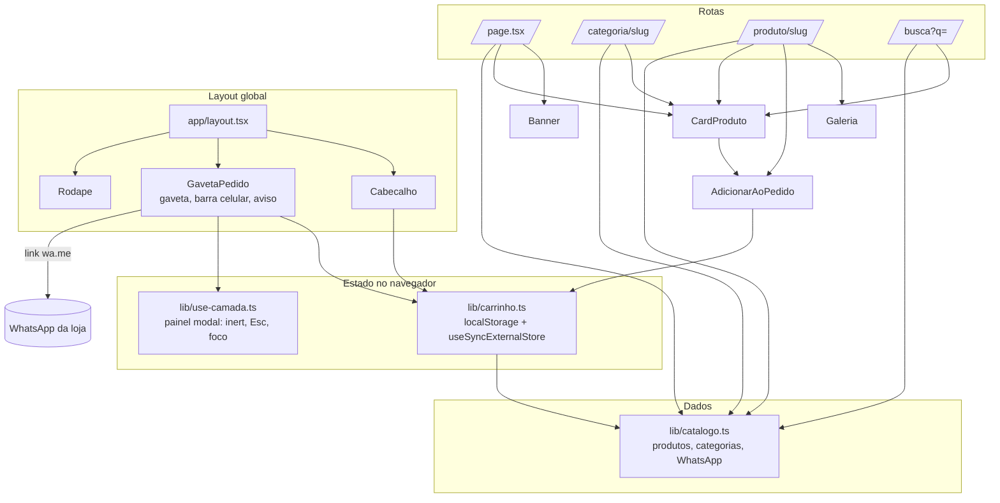
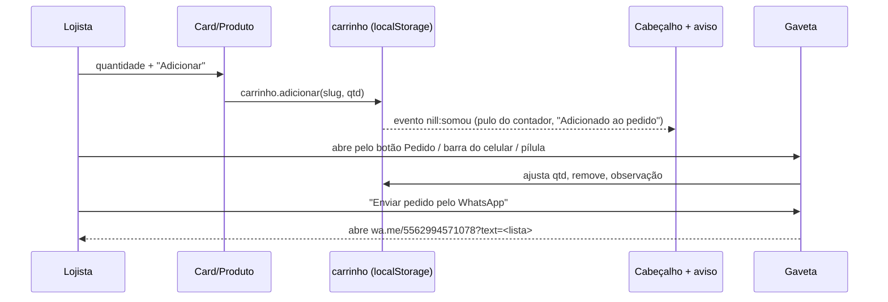

# Codebase Map

> Gerado com Cartographer. Último mapeamento: 2026-10-26.

## Visão geral

A loja do atacado roda em Next.js 16 (App Router, `cacheComponents`) e é 100% estática. Não tem backend, banco nem API. O catálogo é um arquivo TypeScript. O carrinho vive no `localStorage`, e o pedido sai como link `wa.me` com a mensagem pronta.



## Estrutura

```
app/
  layout.tsx            fontes (Rubik, Atkinson Hyperlegible Next), Cabecalho + main + Rodape + GavetaPedido
  globals.css           TODO o CSS; tokens no :root (cores, escala, raio, sombra)
  page.tsx              home: Banner, "Como pedir", vitrine por categoria
  categoria/[slug]/     lista da categoria (generateStaticParams)
  produto/[slug]/       página do produto (galeria, unidade, preço, adicionar, relacionados)
  busca/                page.tsx (Suspense) + resultados.tsx (cliente, useSearchParams)
  not-found.tsx, icon.svg
components/
  Cabecalho.tsx         busca, botão do pedido com contador (gesto "somou")
  GavetaPedido.tsx      gaveta do pedido, barra fixa no celular, aviso role=status
  AdicionarAoPedido.tsx stepper de quantidade + "Adicionar" + pílula "No pedido: n"
  CardProduto.tsx       card (servidor) que embute AdicionarAoPedido (cliente)
  Banner.tsx            carrossel em fade (7 s, pausa em hover/foco/aba escondida)
  Galeria.tsx, Logo.tsx (logo plana em SVG), Icone.tsx (SVG inline), Rodape.tsx
lib/
  catalogo.ts           fonte única de produtos/categorias/WhatsApp; busca sem acento; formatarPreco
  carrinho.ts           store do pedido, mensagem do WhatsApp, estado da gaveta
  use-camada.ts         pilha de painéis modais (inert por data-regiao, Esc, Tab, foco de volta)
public/produtos/        fotos .webp quadradas fundo branco
assets/                 material original do cliente (não servido)
identidade/, design-plan.md, briefing.md, desenvweb-progresso.md   documentos do projeto
```

## Módulos

### Catálogo: `lib/catalogo.ts`
- **Exporta:**
  - os tipos `Produto` e `Categoria`;
  - os dados `WHATSAPP`, `categorias` e `produtos`;
  - as funções `produtoPorSlug`, `categoriaPorSlug`, `produtosDaCategoria`, `buscar` e `formatarPreco`.
- **`preco: number | null`:** `null` significa "Preço sob consulta". Nunca preencha preço inventado.
- **`unidade` e `unidadePlural`:** a `unidade` aparece na pílula amarela e na mensagem do pedido. Medidas usam NBSP (`140 g`) para não partir a linha.
- **`buscar`:** sem acento, todas as palavras precisam aparecer em nome, marca, unidade, detalhe ou categoria.

### Pedido: `lib/carrinho.ts` (cliente)
- **Chave:** `nill:pedido:v1` no `localStorage`, guardando `{ itens: [{slug, qtd}], obs }`.
- **`useCarrinho()`:** usa `useSyncExternalStore`. O snapshot devolve a mesma referência enquanto o texto guardado não muda, e o servidor sempre vê o carrinho vazio. Também sincroniza entre abas pelo evento `storage`.
- **`carrinho.adicionar|definir|remover|observacao|limpar`:** `adicionar` dispara `window` `nill:somou`, que o cabeçalho e o aviso escutam.
- **`mensagemDoPedido`, `linkWhatsApp`:** o total só aparece se todos os itens tiverem preço. Se não, a mensagem pede os preços.
- **`gaveta.abrir/fechar` e `useGaveta()`:** estado global da gaveta.
- **`QTD_MAX = 999`:** o `parse` descarta slug desconhecido ou quantidade inválida.

### Painéis: `lib/use-camada.ts`
`useCamada(aberto, fechar, ref, { manter, focoInicial, retorno })` deixa `[data-regiao]` inert (cabeçalho, conteúdo e rodapé), trava a rolagem com `html.rolagem-travada` e faz Esc e Tab funcionarem só no painel do topo. Ao fechar, devolve o foco a quem abriu o painel; se esse elemento não existir mais, usa o seletor `retorno`.

### UI
- **`AdicionarAoPedido`:** o campo de quantidade é texto numérico (máximo de 3 dígitos). Depois de adicionar, a quantidade volta para 1 e aparece a pílula "No pedido: n", que abre a gaveta.
- **`GavetaPedido`:** fica fora das regiões `data-regiao`, para não ficar inert. Inclui o `.aviso` (role=status, sempre montado) e a `.barra-pedido`, que só aparece no celular quando há itens.
- **`Cabecalho`:** o botão do pedido tem `data-pedido-alvo`, que é o retorno de foco da gaveta. O gesto-assinatura é a classe `.is-somou`, reiniciada com `offsetWidth`.
- **`Banner`:** os slides se sobrepõem no mesmo grid. O inativo fica `inert` e `aria-hidden`. Com movimento reduzido, não há troca automática.

## Fluxo do pedido



## Convenções
- O código, os nomes de arquivo e as classes estão em português. O CSS usa BEM simples (`card__nome`, `botao--azul`).
- **Cores e tamanhos:** só os tokens de `:root` em `globals.css`. Não há Tailwind nem CSS modules.
- **Servidor ou cliente:** componentes são de servidor por padrão. Só leva `'use client'` quem tem estado: Cabecalho, Banner, Galeria, AdicionarAoPedido, GavetaPedido e busca/resultados.
- **Movimento:** só CSS. Animação com mola fica dentro de `@media (prefers-reduced-motion: no-preference)`. Não há GSAP nem Lenis, por decisão do plano (loja).
- **Toque:** todo alvo de toque tem 44 px ou mais. A auditoria de celular cobra isso.

## Armadilhas
- **`cacheComponents: true`** (em `next.config.ts`):
  - `export const dynamicParams` quebra o build;
  - `new Date()` em componente de servidor falha o prerender;
  - a rota anterior fica escondida no DOM depois de navegar (Activity). Em teste, conte só os elementos visíveis.
- **`useSearchParams`** precisa de `<Suspense>`, senão o build falha. Veja `app/busca/page.tsx`.
- **Tipos globais:** `PageProps` e `LayoutProps` são gerados no build. Rodar `tsc` antes do primeiro `next build` dá erro.
- **Logo:** é uma versão provisória redesenhada, e o texto "ATACADO" do SVG depende da fonte Rubik carregada.
- **`AGENTS.md`:** o bloco do Next é reescrito pelo `next dev`. Não apague.

## Guia rápido
- **Adicionar ou editar produto:** edite `lib/catalogo.ts` e ponha a foto em `public/produtos/` (.webp, quadrada).
- **Nova categoria:** acrescente em `categorias` (`lib/catalogo.ts`). Menu, rodapé, home e rotas aparecem sozinhos.
- **Mudar o texto da mensagem do WhatsApp:** `mensagemDoPedido` em `lib/carrinho.ts`.
- **Trocar o número do WhatsApp:** `WHATSAPP` em `lib/catalogo.ts`.
- **Cores e fontes:** tokens em `app/globals.css` e as fontes em `app/layout.tsx`.
- **Slides do banner:** o array `slides` em `components/Banner.tsx`.
